

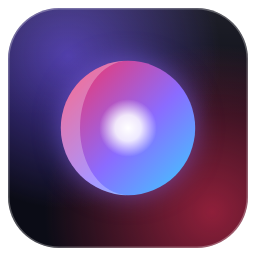

# Lumen

**A glassy, addon-powered streaming app for Windows.**
Bring your own addons and your Real-Debrid account. Lumen turns them into a home screen you'll actually enjoy.

Formerly Prism. Updating from Prism keeps your addons, profiles and history.

**[⬇ Download Lumen for Windows](https://github.com/MrSlappy/prism-releases/releases/latest)**

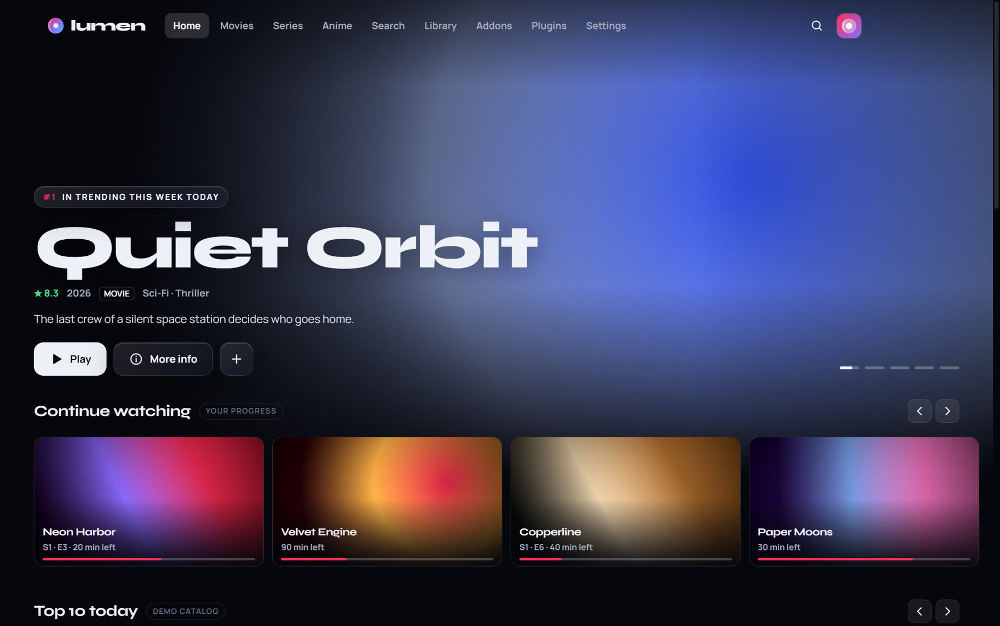

---

## Why Lumen

- **Glass design.** Frosted panels, artwork-tinted light, big type. Somewhere between Netflix and Nuvio.
- **Your addons.** Works with Stremio-compatible addons: catalogs, metadata, streams and subtitles.
- **Real-Debrid built in.** Link your account with a short code. Torrent sources play straight through it.
- **Plays the files other players can't.** Dolby and DTS sound is converted on the fly, so you never get a silent movie. The picture stays untouched.
- **Made for binge-watching.** Skip intro, next episode, and it remembers the source you like.
- **Updates itself.** New versions download in the background. One click to restart.

## See it in action

<a href="https://mrslappy.github.io/prism-releases/media/prism-showcase.mp4">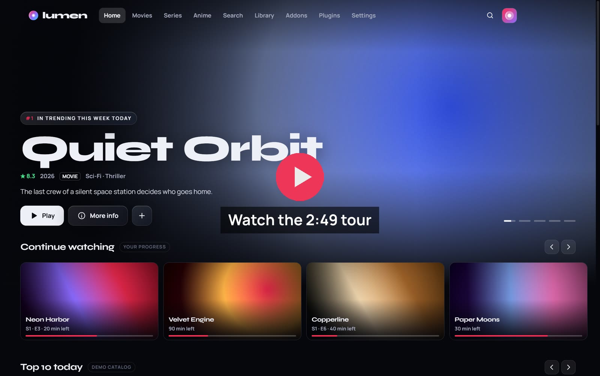</a>

A 2:49 guided tour with music that zooms in on each feature: browsing, sources, the player and its languages, clips, profiles, skip intro, next episode, timing, Play on TV and automatic updates. It was recorded when the app was still called Prism. Tap the picture to play it in your browser, or [download the video](https://github.com/MrSlappy/prism-releases/raw/main/media/prism-showcase.mp4).

## A look around

<table>
  <tr>
    <td width="50%">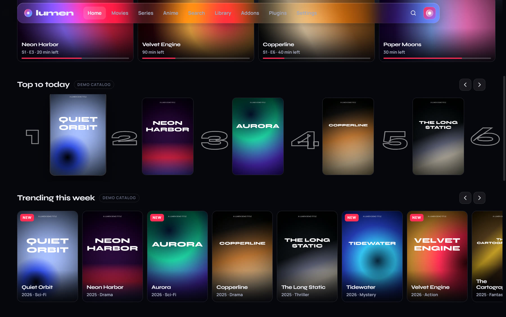 <b>Your catalogs</b> Continue watching, Top 10 and every catalog from your addons.</td>
    <td width="50%">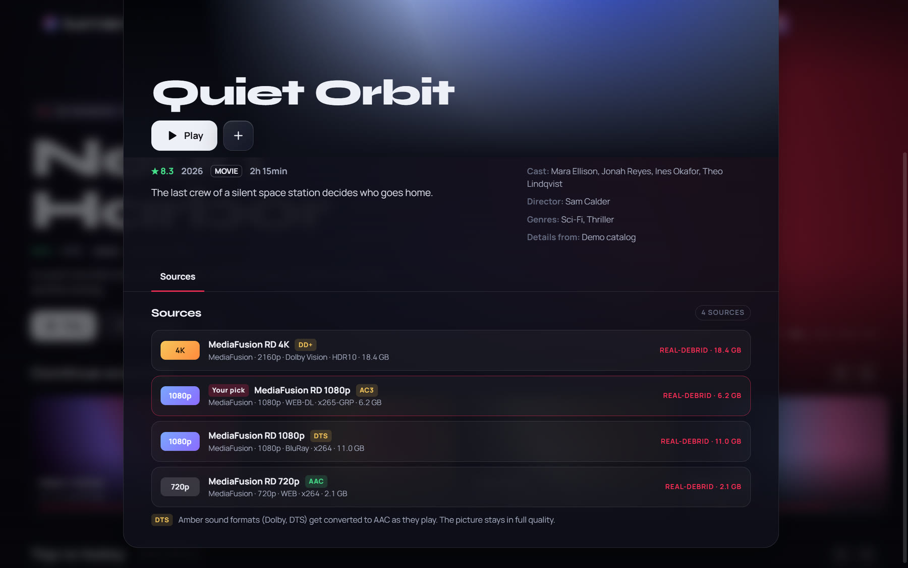 <b>Details and sources</b> Every source in one list, with quality, size and sound format. <i>Your pick</i> marks the one you chose last time.</td>
  </tr>
  <tr>
    <td>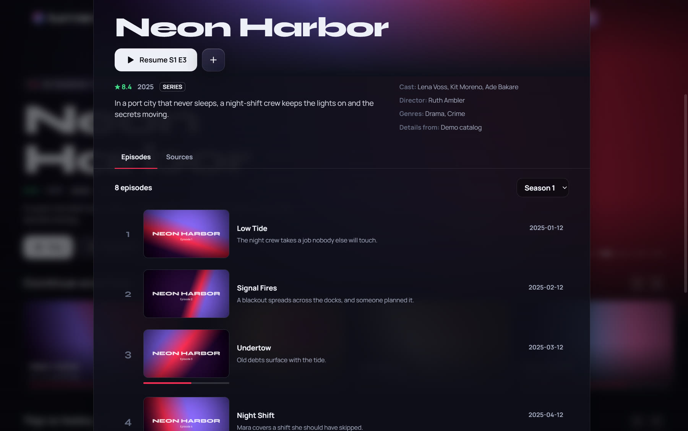 <b>Seasons and episodes</b> Lumen remembers where you stopped in every show.</td>
    <td>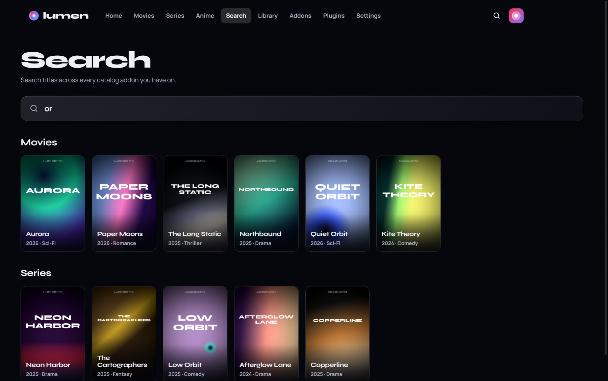 <b>Search everything</b> One search across all the catalogs you have installed.</td>
  </tr>
  <tr>
    <td>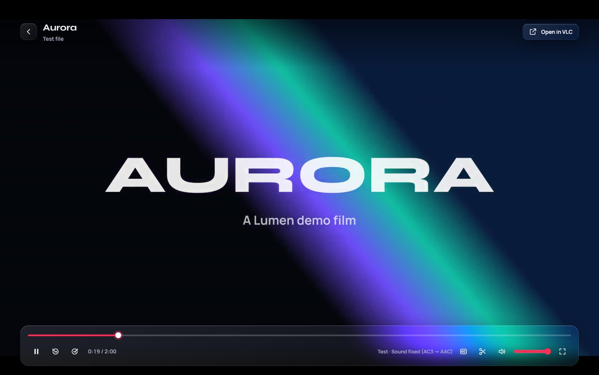 <b>The player</b> Glass controls, keyboard shortcuts, resume where you left off. Press <code>E</code> to jump to another episode.</td>
    <td>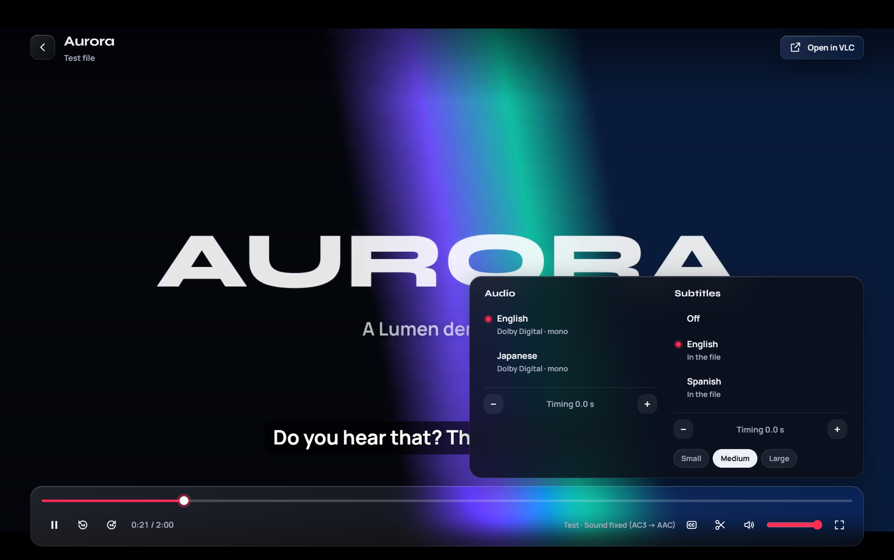 <b>Languages</b> Switch audio language and subtitles (from the file or OpenSubtitles), resize them, fix their timing.</td>
  </tr>
  <tr>
    <td>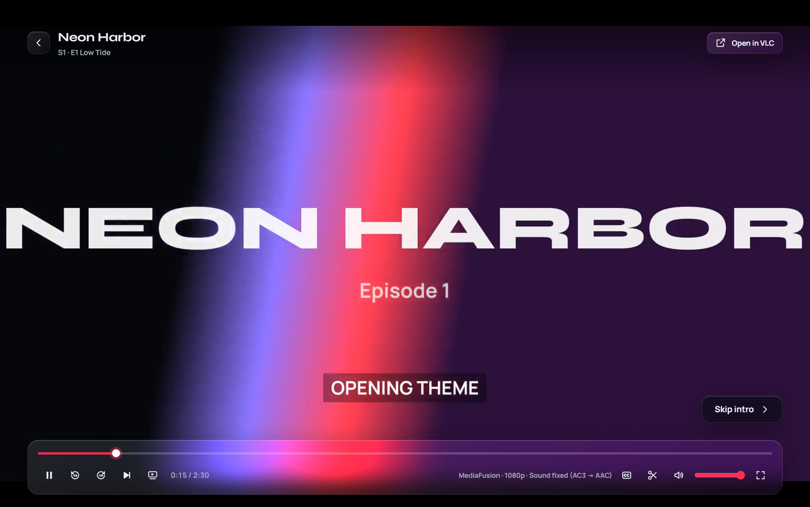 <b>Skip intro</b> Appears during openings and recaps that the episode marks with chapters.</td>
    <td>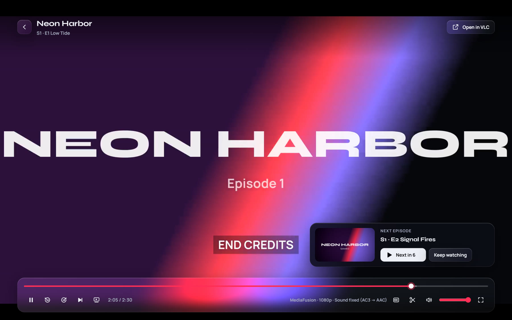 <b>Next episode</b> At the credits, the next episode starts by itself with the same kind of source and your languages.</td>
  </tr>
  <tr>
    <td>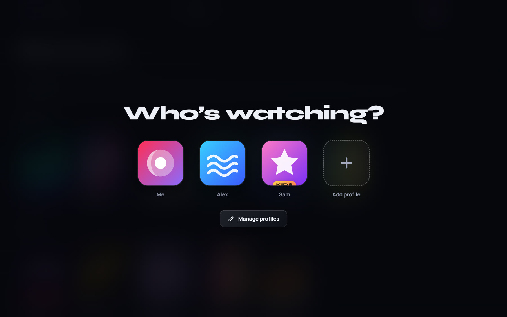 <b>Profiles</b> Everyone gets their own history, My List, subtitle settings and avatar. Kids profiles only show titles rated for their age.</td>
    <td>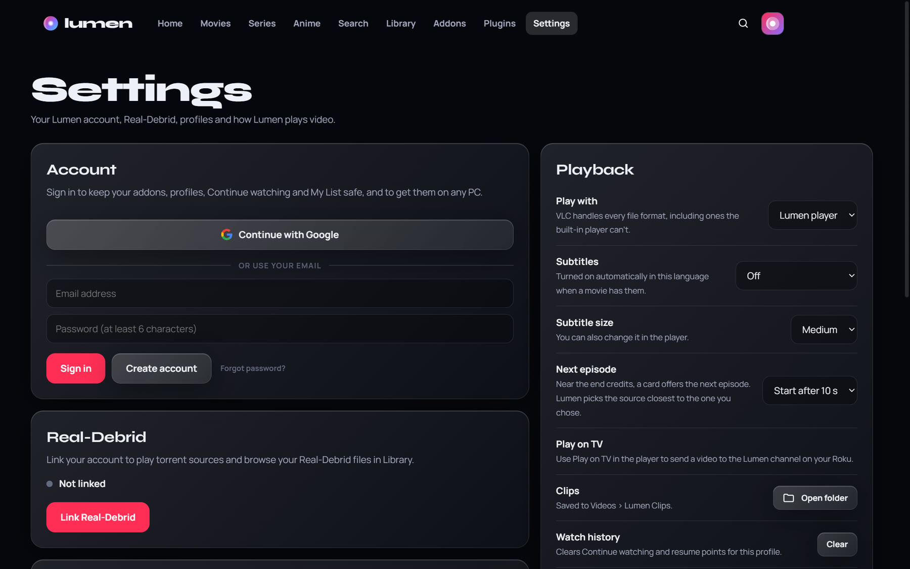 <b>Settings</b> Your account, Real-Debrid, Usenet, playback, clips and updates in one place.</td>
  </tr>
</table>

Screenshots use a demo catalog with made-up titles and artwork. Lumen shows whatever your own addons provide.

## All the features

| | |
|---|---|
| 🎬 **Browse** | Home, Movies and Series pages, rotating hero, Top 10, Continue watching, My List |
| 🏷️ **Genres** | Pick a genre on Movies and Series, plus picks from around the world: K-drama, Bollywood and more |
| 🌸 **Anime** | Its own tab: browse by genre, year, season, tag and studio, search with an optional 18+ switch, and a separate Anime shelf in Library |
| 🧩 **Addons** | Install any Stremio-compatible addon from its link (or `stremio://` link); turn each on or off |
| 🔌 **Plugins** | Add Nuvio-style provider repositories; they run in a locked-down sandbox and their sources load alongside your addons |
| ⚡ **Real-Debrid** | Device-code linking, plays torrent sources, browse your Real-Debrid downloads and torrents in Library. Blocked or missing files are skipped automatically |
| 📰 **Usenet** | TorBox (NZB results from your addons) and Easynews (searched for every title) next to your torrent sources |
| 🔎 **Sources** | Every addon and plugin loads at the same time; language tags and a language filter on each source |
| 🔊 **Sound fix** | Dolby Digital, DD+, TrueHD and DTS converted to AAC while you watch, picture untouched |
| 🌍 **Languages** | Pick any audio track in the file, subtitles from the file (picture subtitles included) or from OpenSubtitles, three sizes, auto-select your language |
| ⏱️ **Timing** | Shift subtitles or sound in 0.1 s steps when they're out of sync |
| ⏭️ **Binge mode** | Skip intro / recap, next-episode countdown, remembered source per show |
| ✂️ **Clips** | Save the last 15, 30 or 60 seconds as an MP4, or a full-resolution still (HDR converted to normal color) |
| 📺 **Play on TV** | Send what you're watching to the Lumen channel on a Roku |
| 👥 **Profiles** | Separate history, list and settings per person, custom avatars, kids profiles with an age limit and a parent PIN |
| ☁️ **Account** | Optional sign-in with email or Google keeps your addons, profiles and history in sync across PCs; addon links are locked with your own PIN |
| 🔄 **Auto-update** | Checks this page, downloads in the background, verifies the file, installs on restart |
| 🎞️ **VLC hand-off** | One click to open any source in VLC, or make VLC the default player |

## Install

1. Download **`Lumen-Setup-x.y.z.exe`** from the [latest release](https://github.com/MrSlappy/prism-releases/releases/latest).
2. Run it. Windows SmartScreen may say *"Windows protected your PC"* because the app isn't code-signed yet. Choose **More info → Run anyway**.
3. Open Lumen, go to **Addons** and paste the link of the addons you use, then **Settings → Link Real-Debrid** if you have an account.

Updating is automatic from version **1.2.1** on. Prefer no install? There's a **portable** `.exe` in each release too, but it doesn't update itself.

**Needs:** Windows 10 or 11 (64-bit). A Real-Debrid premium account is optional, but most stream addons need one.

## Keyboard shortcuts

| Key | Action | Key | Action |
|---|---|---|---|
| `Space` / `K` | Play / pause | `T` | Audio & subtitles menu |
| `←` `→` | Back / forward 10 s | `C` | Clip the last 30 s |
| `↑` `↓` | Volume | `S` | Skip intro |
| `F` | Full screen | `N` | Next episode |
| `M` | Mute | `G` / `H` | Subtitles earlier / later |
| `E` | Episodes | | |
| `Esc` | Close the player | `Shift`+`G` / `H` | Sound earlier / later |

## Questions

**Where do the movies come from?**
Lumen doesn't host, index or provide any content. Like Stremio, it only shows what the addons *you* install return, and plays links through services *you* connect. You're responsible for what you install and watch.

**A source has no sound.**
Lumen detects Dolby/DTS sound and fixes it automatically. If a file still won't play, use **Open in VLC** in the player.

**Does it phone home?**
No tracking. Lumen talks to your addons, the services you connect (Real-Debrid, TorBox, Easynews), OpenSubtitles (if installed), TMDB and AniList for genres, anime and age ratings, and this GitHub page to check for updates. An account is optional: if you sign in, your saved data is stored in your account so it can sync, with your addon links encrypted by a PIN only you know.

## Credits and licenses

Lumen is built with [Electron](https://www.electronjs.org/) (MIT) and [hls.js](https://github.com/video-dev/hls.js) (Apache-2.0), with Manrope and Syne fonts (SIL Open Font License).
It ships an unmodified [FFmpeg](https://ffmpeg.org/) 6.1.1 build from [gyan.dev](https://www.gyan.dev/ffmpeg/builds/) via [ffmpeg-static](https://github.com/eugeneware/ffmpeg-static), licensed under the GPL v3; its source code is available from [ffmpeg.org](https://ffmpeg.org/download.html#releases) and the gyan.dev build page.

---

Lumen for Windows · made with Electron and FFmpeg · <a href="https://github.com/MrSlappy/prism-releases/releases">All releases</a>

